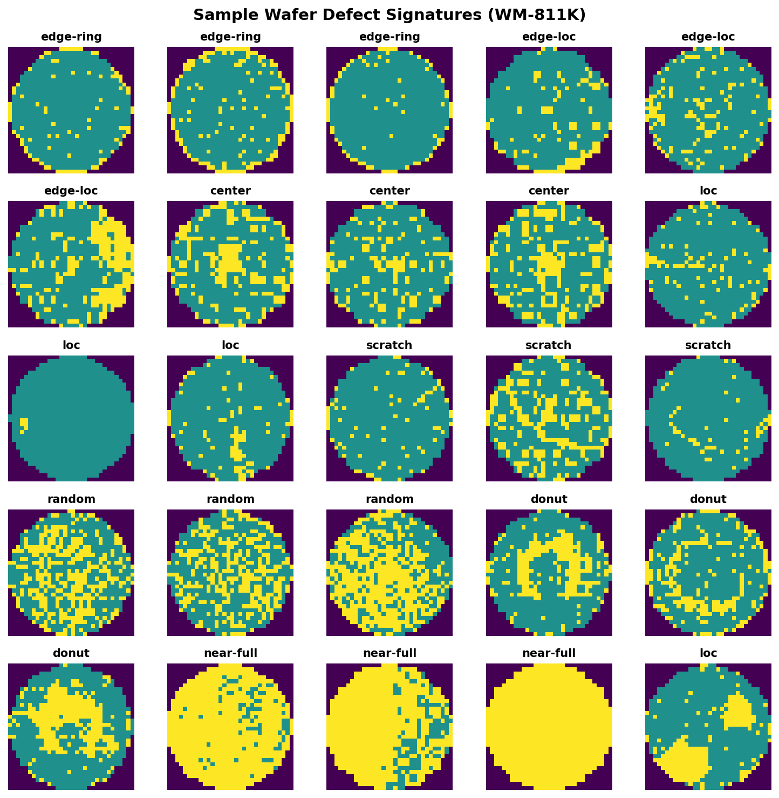

# 🔬 Automated Signature Identification in VLSI Metrology & Generative Defect Synthesis

[](https://www.python.org/)
[](https://pytorch.org/)
[](https://scikit-learn.org/)
[](LICENSE)

An end-to-end framework for **semiconductor wafer fabrication metrology** utilizing the **WM-811K wafer map dataset**. This repository combines classical machine learning classification (spatial feature engineering, class imbalance correction, and ensemble modeling) with modern deep generative architectures (Conditional Variational Autoencoders & Conditional GANs) to achieve **bidirectional defect analytics**.



---

## 📌 Executive Summary & Key Highlights

During semiconductor wafer manufacturing, defect patterns on wafer maps (spatial distributions of failing dies) serve as fingerprints for specific process abnormalities—such as chemical-mechanical planarization (CMP) errors, spin-coating non-uniformities, or robotic handling scratches.

This project delivers a **dual-paradigm solution**:

1. **Predictive Analytics (ML Classifier)**:
   $$\text{Wafer Map } X \xrightarrow{\text{22 Spatial & Geometric Features}} \text{Tuned Classifier} \xrightarrow{} \text{Failure Signature } y$$
   - Extracts 22 spatial features per wafer (density, centroid moments, cluster metrics, edge/die ratios).
   - Resolves severe class imbalance using **SMOTETomek** resamplers.
   - Benchmarks Random Forest, XGBoost, MLP, Gradient Boosting, KNN, and Logistic Regression (**Accuracy: >95.9%**, **ROC-AUC: >0.998**).

2. **Inverse Generative Synthesis (Deep Learning)**:
   $$\text{Failure Class } y + \text{Latent Noise } z \sim \mathcal{N}(0, I) \xrightarrow{\text{Conditional VAE / cGAN}} \text{Realistic Synthetic Wafer Map } \hat{X}$$
   - Synthesizes realistic 32×32 wafer defect maps on demand for any designated failure category.
   - Provides continuous **latent space defect interpolation** (morphing between signatures, e.g., *center* $\to$ *donut*).
   - Generates synthetic samples to balance and augment downstream classification datasets.

---

## 🚀 Quickstart: Running the Code

### 1. Requirements Installation

Clone the repository and install dependencies inside a virtual environment:

```bash
git clone https://github.com/<your-username>/<your-repo-name>.git
cd wafer
pip install -r requirements.txt
```

---

### 2. Machine Learning Pipeline (Classification)

To run the **Machine Learning** end-to-end pipeline (data exploration, 22-feature extraction, SMOTETomek balancing, dimensionality reduction, model comparison, and clustering):

👉 **Run the Jupyter Notebook:**
```bash
jupyter notebook wafermap_fixed.ipynb
```
> **Notebook**: [`wafermap_fixed.ipynb`](wafermap_fixed.ipynb)  
> Covers data loading, EDA with 12 visual figures, feature engineering, baseline & hyperparameter-tuned classifiers, and K-Means/DBSCAN spatial clustering.

---

### 3. Deep Learning Pipeline (Generative Modeling)

To run the **Deep Learning** conditional generative pipeline (cVAE and cGAN training, loss profiling, on-demand generation, defect morphing, and synthetic dataset export):

👉 **Run the Jupyter Notebook:**
```bash
jupyter notebook dl/wafer_generative_dl.ipynb
```
> **Notebook**: [`dl/wafer_generative_dl.ipynb`](dl/wafer_generative_dl.ipynb)  
> Interactive notebook that loads the bundled 32×32 preprocessed dataset, trains the Conditional VAE, inspects reconstruction fidelity, and performs latent defect morphing.

#### CLI Generative Tools (Alternative to Notebook)
You can also generate wafer maps directly from the terminal using pre-trained weights:

- **Generate 8 synthetic wafers for a specific defect class:**
  ```bash
  python dl/generate.py --class center --count 8 --output dl/outputs/center_defect.png
  ```

- **Generate a comparison grid across all 8 defect classes:**
  ```bash
  python dl/generate.py --all-classes --count 5 --output dl/outputs/all_classes.png
  ```

- **Morph smoothly between two defect types (latent space interpolation):**
  ```bash
  python dl/generate.py --morph --from-class center --to-class donut --steps 8 --output dl/outputs/morph_center_donut.png
  ```

- **Train a fresh cVAE model via CLI:**
  ```bash
  python dl/train_cvae.py --epochs 25 --batch-size 128 --beta 0.5
  ```

- **Quick dataset preview:**
  ```bash
  python sample_visualisation.py
  ```

---

## 📁 Repository Structure

```
wafer/
├── Automated-Signature-Identification-in-VLSI-Metrology.pptx  # 📊 Project Presentation Slide Deck
├── report/                                                    # 📄 Project Report Directory
│   └── README.md                                              # Placeholder & instructions for project report
├── requirements.txt                                           # Python dependency specifications
├── .gitignore                                                 # Git ignore rules for caches & large datasets
├── sample_visualisation.py                                    # Standalone script to preview wafer maps
├── sample_output.png                                          # Visual preview of labeled wafer signatures
├── wafermap_fixed.ipynb                                       # 🧠 ML Pipeline (Run for Machine Learning)
├── wafer_dl_proposal.md                                       # Detailed architecture and proposal notes
└── dl/                                                        # 🔬 Deep Learning Generative Module
    ├── README.md                                              # DL Module Documentation
    ├── wafer_generative_dl.ipynb                              # 🧠 DL Pipeline (Run for Deep Learning)
    ├── dataset.py                                             # PyTorch Dataset, loader & preprocessing
    ├── utils.py                                               # Plotting utilities & custom colormaps
    ├── train_cvae.py                                          # CLI training script for cVAE
    ├── generate.py                                            # CLI generation & defect interpolation tool
    ├── checkpoints/
    │   └── best_cvae.pt                                       # Trained cVAE model weights
    ├── data/
    │   └── wafer_labeled_32x32.npz                            # Bundled preprocessed labeled dataset (~4.3MB)
    ├── models/
    │   ├── __init__.py
    │   ├── cvae.py                                            # Conditional Variational Autoencoder
    │   └── cgan.py                                            # Conditional GAN (cDCGAN)
    └── outputs/                                               # Generated defect grids & morphing images
        ├── center_defect.png
        ├── generation_epoch_02.png
        └── morph_center_donut.png
```

---

## 🏷️ The 8 Failure Signature Classes

The WM-811K benchmark contains **25,519 expert-labeled wafers** categorized into 8 distinct failure modes:

| Failure Signature | Count | Percentage | Real-World VLSI Semiconductor Cause |
|---|---|---|---|
| **`edge-ring`** | 9,680 | 37.9% | Bevel/clamp ring defect, CMP slurry buildup, edge bead removal failure |
| **`edge-loc`** | 5,189 | 20.3% | Wafer edge chipping, chuck pin contact damage, physical handling stress |
| **`center`** | 4,294 | 16.8% | Spin-coating non-uniformity, gas flow stagnation during CVD/etching |
| **`loc`** | 3,593 | 14.1% | Localized particle contamination, photolithography reticle defect |
| **`scratch`** | 1,193 | 4.7% | Robotic transfer arm scratch, mechanical tweezer slippage |
| **`random`** | 866 | 3.4% | General cleanroom airborne particulates, chamber condensation |
| **`donut`** | 555 | 2.2% | Mid-radius thermal gradients, plasma non-uniformity, RF coil misalignment |
| **`near-full`** | 149 | 0.6% | Catastrophic process failure, power excursion, complete etch breakdown |

---

## 📊 Project Presentation & Final Report

- **Presentation Slides**: The project slide deck is included in the repository root as [`Automated-Signature-Identification-in-VLSI-Metrology.pptx`](Automated-Signature-Identification-in-VLSI-Metrology.pptx). It outlines the metrology problem statement, feature engineering methodology, ML benchmarking, and generative synthesis results.
- **Project Report**: The finalized documentation report (PDF/DOCX) can be placed in the [`report/`](report/) directory.

---

## 💾 Dataset Setup & GitHub Compatibility

- **DL Module Dataset (Included)**: The preprocessed 32×32 dataset containing all 25,519 labeled wafer maps is directly included at [`dl/data/wafer_labeled_32x32.npz`](dl/data/wafer_labeled_32x32.npz) (~4.3 MB). You can run the Deep Learning notebook immediately without downloading external files.
- **Raw WM-811K Dataset (Optional for ML Pipeline)**:
  - If you wish to re-run the raw data extraction in [`wafermap_fixed.ipynb`](wafermap_fixed.ipynb), download `LSWMD.pkl` (or `LSWMD.csv`) from [Kaggle WM-811K Wafer Map Dataset](https://www.kaggle.com/datasets/qingyi/wm811k-wafer-map) and place it in the project root.
  - *Note*: Raw datasets exceeding GitHub's 100MB limit (`LSWMD.csv` / `LSWMD.pkl`, ~600MB) are automatically excluded via `.gitignore` to ensure clean and problem-free git pushes.

---

## 🛠️ Step-by-Step Instructions: Pushing to GitHub

To push this repository to your GitHub account:

1. **Initialize Git and Stage Files:**
   ```bash
   git init
   git add .
   ```

2. **Commit Changes:**
   ```bash
   git commit -m "Initial commit: Automated VLSI Wafer Signature Identification & Generative Synthesis"
   ```

3. **Link to Your GitHub Repository:**
   ```bash
   git branch -M main
   git remote add origin https://github.com/<your-username>/<your-repo-name>.git
   ```

4. **Push to Remote:**
   ```bash
   git push -u origin main
   ```

*(If you add your report to `report/` later, simply run `git add report/`, `git commit -m "Add project report"`, and `git push`.)*

---

## 📜 License

This project is licensed under the MIT License — see the LICENSE file for details.
